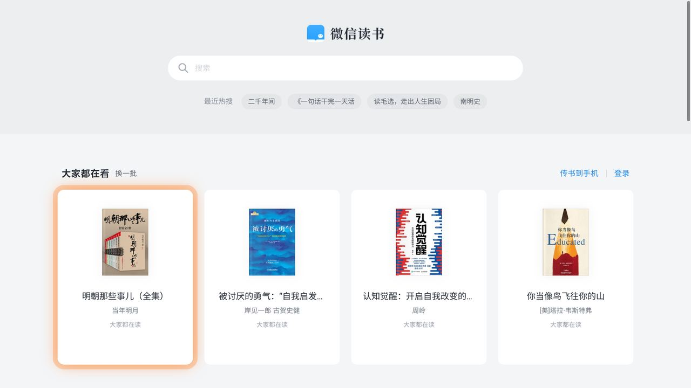
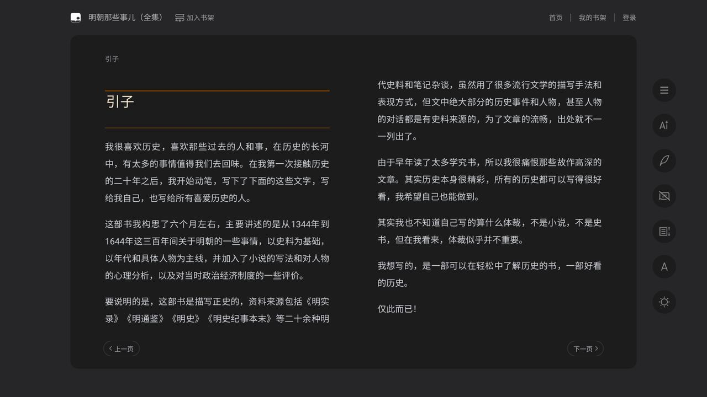
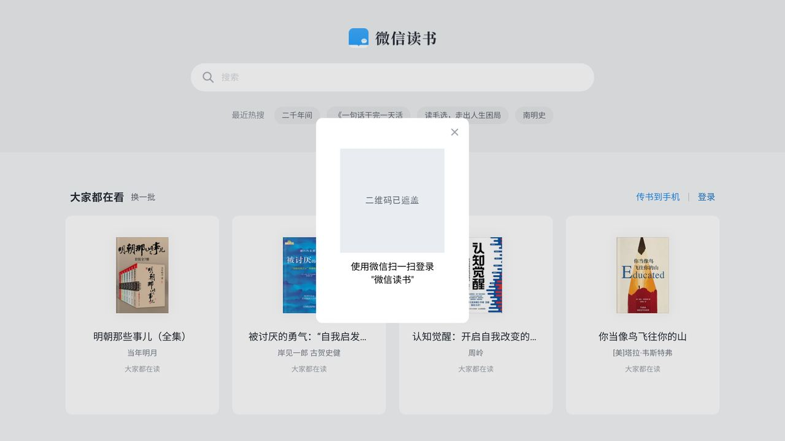

<div align="center">

# WeReadTV

**在电视上用遥控器读书 —— 微信读书网页版的 Android TV 壳**

[](https://github.com/l5oo00/weread-tv/actions/workflows/build.yml)
[](./LICENSE)


焦点导航 · 自由光标 · 滚动模式 · 扫码登录

**非官方个人项目，与腾讯 / 微信读书无关联、授权或背书**（见下方声明）

</div>

---

## 这是什么

一个极简的 Android TV 应用：打开[微信读书](https://weread.qq.com)网页版，把遥控器按键翻译成页面操作。书、书架与账号都来自原站，本项目不修改网站、不提供内容，也不需要 root。

应用自带浏览器引擎，不依赖电视系统的 WebView 版本；不同电视的系统环境差异不影响使用。

## 功能

- **焦点导航**：方向键在书卡 / 页面控件之间移动橙色焦点框，OK 打开。
- **自由光标**：菜单键或**长按 OK** 呼出鼠标箭头，方向键像素级移动（短按微调、长按加速），OK 点击；评论、笔记、排版切换这类焦点走不到的地方也能操作。
- **滚动模式**：自由光标下再按一次菜单键进入，光标停在原地，方向键四向滚动页面（单按小步、连按逐渐加速），OK 仍在光标处点击。
- **阅读页三层模式**：默认方向键翻页（竖屏长页排版下上下键改为滚动）→ OK 进焦点模式操作右侧工具栏 → 菜单键 / 长按 OK 进自由光标。
- **登录与排版**：首次用手机扫码登录，之后免登录；首页四列、书架七列、阅读页左右双页，按大屏统一缩放。

> 每按一次**返回键**只退一层：滚动 → 自由光标 → 常规模式；菜单键逐层进入，不会重复进入或误退出。
> 阅读页开到弹层时（目录、书评、字体、笔记、AI…）返回键先关弹层，**不会顺手把光标也退掉**。

## 遥控器键位

| 按键 | 首页 / 书架 | 阅读页（默认） | 阅读页 · 焦点模式 | 自由光标模式 | 滚动模式 |
|---|---|---|---|---|---|
| **方向键** | 移动焦点框 | 左右翻页；上下滚动一屏（分页排版下上下也是翻页） | 在工具栏间移动焦点 | 移动光标 | 四向滚动 · 单按小步 / 连按加速 |
| **OK 短按** | 点击焦点 | 进入焦点模式 | 点击焦点 | 在光标处点击 | 在光标处点击 |
| **OK 长按** | 呼出光标 | 呼出光标 | 呼出光标 | — | — |
| **菜单键** | 呼出光标 | 呼出光标 | 呼出光标 | 进入滚动模式 | — （已在滚动模式） |
| **返回键** | 回上级 / 关弹窗 / 退出 | 关阅读页弹层 → 回进书前的页面 | 关弹层 → 退回阅读模式 | 关弹层 → 退回常规模式 | 回到自由光标模式 |

> 阅读页的返回键优先级是：**滚动模式 → 页面弹层 → 模式栈 → 页面导航**。弹层指站点自己的
> 目录 / 书评 / 字体 / 笔记 / AI 问书 / 各类对话框：左上角有返回箭头的先点返回（子页回列表），
> 没有返回的点关闭，再没有的就点遮罩空白处（站点自己的「点外面关掉」）。

> 常规模式下菜单键或长按 OK 都能进入自由光标；滚动模式目前只有菜单键一个入口，没有菜单键的遥控器可用长按 OK 到自由光标。

> 站点有两种排版：**分页**（横屏双栏，底部有「上一页 / 下一页」）和**竖屏长页**（整章一张长页，
> 要滚动才能读到后面）。阅读模式下上下键不去猜是哪一种 —— 直接试着滚一屏，滚动了就算数，
> 滚不动就当成翻页。所以分页排版下上下键仍然是翻页，长页排版下上下键滚动、滚到章末继续按
> 会直接进入下一章，左右键始终是翻页。右侧工具栏第四个（横屏时第五个）图标可以手动切换这两种排版。

## 安装

到 [GitHub Releases](https://github.com/l5oo00/weread-tv/releases) 下载最新的 **release** APK。
文件名带 `v7a` 是 32 位（多数电视 / 老盒子），带 `arm64` 是 64 位新电视；拿不准
先试 `v7a`，装不上再换 `arm64`。

把下载好的 APK 传到电视上打开安装即可（U 盘、电视自带文件管理器、手机传文件
等都行，不同电视的入口不一样）。**不熟悉装 APK 也不用自己折腾**：把电视型号和
下载到的文件名发给你常用的 AI 助手，让它一步步带你操作；需要命令行时也可以
让它把命令写好并解释清楚。

覆盖安装保留登录态；清除数据或卸载等同于退出登录，详见 [安全与隐私](./SECURITY.md)。
想自己构建见[参与贡献](./CONTRIBUTING.md)。

## 首次启动（未登录）

首次安装是**未登录**状态，首页会正常显示「大家都在看」书卡与搜索框，不会白屏或
报错。方向键移动橙色焦点框，OK 打开；右上角有「登录」入口。



未登录也能浏览首页、用「换一批」换推荐，还能点开书直接读到试读正文——
**打开书不会被强制登录**，左右双页、方向键翻页与右侧工具栏都照常可用：



只有需要书架、阅读进度等个人数据时才要登录：点右上角「登录」，用手机微信扫码：



> 登录二维码含一次性凭据，已打码遮盖。
> 登录态保存在应用私有目录，覆盖安装不丢失；清除数据或卸载等同于退出登录，
> 详见 [安全与隐私](./SECURITY.md)。

## 已知限制

- 微信读书前端改版可能让部分按钮暂时点不动或焦点错位，遇到请提 Issue（附机型与截图）。
- 目前只在一台 32 位 / 1080p / Android 10 的国产电视（小米系 ROM）上做过完整真机回归；其他电视 / 盒子的表现欢迎反馈。
- 部分遥控器没有菜单键：长按 OK 仍可进自由光标，但暂时用不了滚动模式。

## 验包与安全

只从本仓库 Releases 下载 APK，下载后用发布页附的 `SHA256SUMS` 校验完整性，并核对证书指纹：

```bash
sha256sum -c SHA256SUMS
apksigner verify --print-certs WeReadTV-v0.1.0-v7a.apk
```

当前发布证书（项目专用，密钥离线保管、不入库）：

```
SHA-256: 36c5979a228b4dcb288b0e0bfd3fa7c3b056a1136b37d547184c739253209f62
DN: CN=WeReadTV, O=WeReadTV, C=CN
```

指纹对不上就不要安装。不会用命令行也可以把这两条命令、下载到的 APK 和
`SHA256SUMS` 一起交给 AI 助手，让它帮你核对。详见 [安全与隐私](./SECURITY.md)。

## 非官方声明与使用条款

**WeReadTV 是非官方的个人实验项目，与腾讯、微信读书（WeRead）没有任何关联、
授权、认可或背书。**「微信读书」及相关商标、站点内容、书籍版权归各自权利人所有。
本项目只是一个加载公开网页的浏览器壳：不修改站点、不提供破解 / 绕过付费 /
批量下载 / 自动刷阅读时长等功能，所有内容仍由原站实时提供。

使用前请了解：

- 以非官方客户端访问第三方服务可能不符合其服务条款，由此产生的账号风险
  由使用者自行承担；若权利方提出异议，本项目会配合调整或停止相关功能。
- 应用显示名为 WeRead，仅用于标识本项目，不代表官方身份，亦未获授权使用
  「微信读书」相关品牌。启动图标与 TV banner 目前沿用了微信风格的对话气泡
  图形，仅作个人实验用途；如涉及商标或图标侵权，请通过 Issues 联系，收到即撤改或更换。
- 项目按「现状」提供，不保证站点改版后仍可用，不作任何明示或暗示担保。
- 不含广告、遥测、崩溃上报或第三方统计 SDK；数据处理与验包见
  [安全与隐私](./SECURITY.md)。
- 请勿用于任何商业用途。

## 相关文档

[参与贡献（含构建与发布说明）](./CONTRIBUTING.md) · [技术内幕](./docs/tech-notes.md) ·
[安全与隐私](./SECURITY.md) · [第三方许可](./THIRD_PARTY_LICENSES.md)

## License

本项目自写代码采用 [MIT](./LICENSE)。APK 内含 GeckoView（MPL-2.0）等第三方
二进制，其许可与源码获取方式见 [THIRD_PARTY_LICENSES.md](./THIRD_PARTY_LICENSES.md)。
